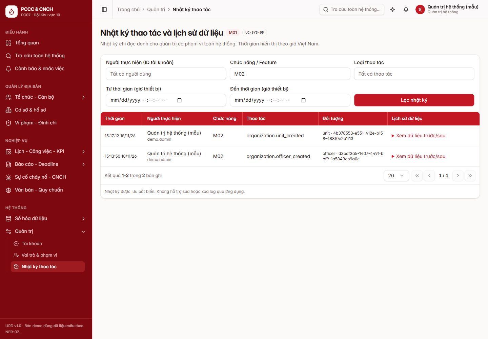
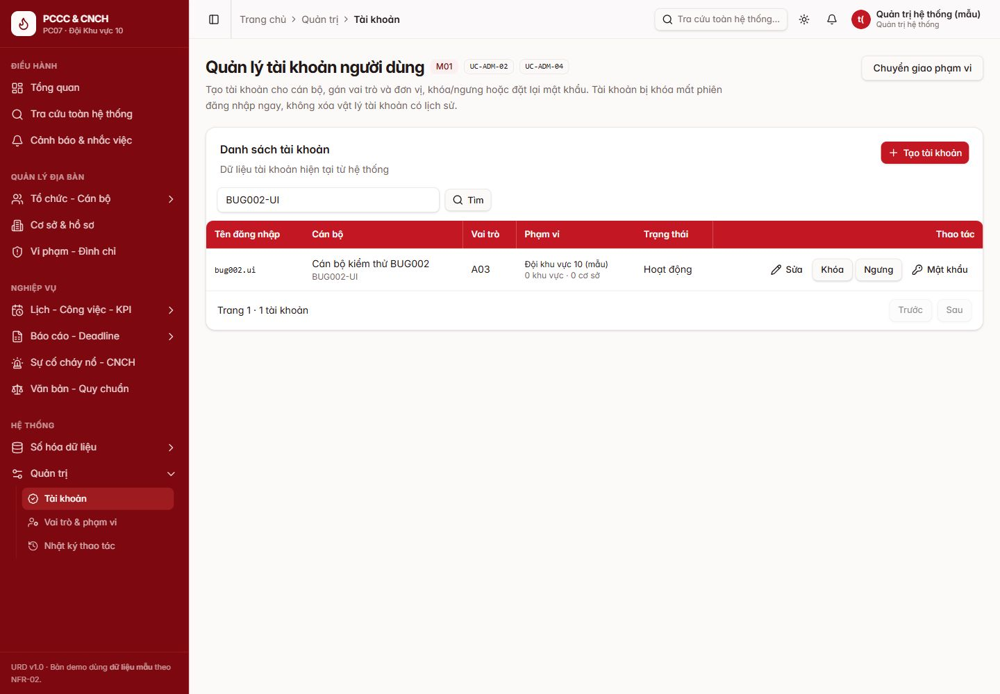

# Retest BUG-001 và BUG-002 — 18/11/2026

STATUS: DONE

Đã fetch và fast-forward checkout từ `812a65a` lên `origin/main` tại `efcebe7`.
Giữ nguyên các thay đổi local có sẵn trong `AGENTS.md`, `pccc-FE/tsconfig.json` và các tài liệu
chưa được Git theo dõi. Bản sửa được đóng gói trên nhánh `codex/fix-bug-001-002` để người dùng
tự tạo merge request vào `main`.

## Kết quả trước và sau sửa

| Bug     | Main `efcebe7`                                                                                       | Sau sửa                                                                                                                                                                                       |
| ------- | ---------------------------------------------------------------------------------------------------- | --------------------------------------------------------------------------------------------------------------------------------------------------------------------------------------------- |
| BUG-001 | Service audit gán thao tác `organization.*` thành `M01.authorization` / `account`.                   | Log mới thuộc `M02`, đúng loại `unit`, `officer`, `region`; API đọc/lọc/phân trang log cũ theo loại đúng mà không cập nhật lịch sử gốc.                                                       |
| BUG-002 | Nhập mã cán bộ tạo được tài khoản nhưng lưu mã vào `accounts.officer_id`; không khớp UUID của hồ sơ. | Tạo/sửa tài khoản ánh xạ mã sang `officers.id`, hỗ trợ mã khác hoa thường và khoảng trắng; từ chối mã không tồn tại hoặc cán bộ đã có tài khoản. UI hiển thị, tìm kiếm và sửa bằng mã cán bộ. |

Baseline được tái hiện bằng service lấy trực tiếp từ commit `efcebe7`, chạy trên PostgreSQL
server riêng; không thay file source đang sửa. Xem [baseline-evidence.json](baseline-evidence.json).

Database kiểm thử chính là **PostgreSQL 18.0 server**, cổng local `55432`, với
`PCCC_TEST_DATABASE_URL=postgresql://pccc_test@127.0.0.1:55432/postgres`.
Các fixture `:memory:` được adapter tạo thành database PostgreSQL server riêng và dọn khi đóng.
Một số test persistence hiện có dùng thư mục PGlite (cũng là PostgreSQL nhúng). Không dùng SQLite.
Không chạy migration/seed trên database có sẵn của người dùng.

## UI → frontend proxy → API → database

Frontend production tại `http://127.0.0.1:3100`, backend riêng tại `127.0.0.1:4000`.
Đã thao tác bằng form UI trên dữ liệu giả lập:

1. Đăng nhập `demo.admin`; tạo hồ sơ `BUG002-UI`: `POST /api/officers` → `201`.
2. Tạo tài khoản `bug002.ui` với mã `bug002-ui`: `POST /api/authorization/accounts` → `201`.
3. Reload, tìm bằng `BUG002-UI`, mở sửa và lưu: GET danh sách/chi tiết → `200`, PUT → `200`.
4. Mã không tồn tại → API `400`, UI hiển thị lỗi; mã đã có tài khoản → `409`, UI hiển thị lỗi.
   Không có tài khoản `bug002.invalid` trong database. Có một lần proxy gặp `ECONNRESET`;
   gửi lại cùng form nhận đúng `409`, không tạo thêm dữ liệu.
5. Tạo đơn vị `BUG001-UI`: `POST /api/units` → `201`.
6. Mở nhật ký, lọc `M02`: GET `/api/audit-logs?...feature=M02` → `200`, thấy cả log đơn vị và
   cán bộ với loại đối tượng đúng. Kiểm tra desktop và bố cục mobile hiện có; bảng cuộn ngang.
7. Đọc API qua frontend proxy và truy vấn JOIN PostgreSQL độc lập: `accounts.officer_id` bằng
   `officers.id`, khác `officer_code`; hồ sơ trả `linkedAccountCount: 1`.

Chi tiết phản hồi API và kết quả JOIN: [api-database-evidence.json](api-database-evidence.json).
Chỉ lưu dữ liệu giả lập; không lưu cookie hoặc mật khẩu từ phản hồi đăng nhập.
Nhật ký HTTP không chứa request body được lưu local ở `http.log` (gitignored).





## Kiểm chứng thực tế

| Gate                                       | Kết quả                                                                                                     |
| ------------------------------------------ | ----------------------------------------------------------------------------------------------------------- |
| Backend suite với `PCCC_TEST_DATABASE_URL` | PASS — 178/178, `node --test --test-concurrency=2 pccc-BE/test/*.test.js`                                   |
| Regression BUG-001/002 lần cuối            | PASS — 2/2, gồm log cũ, phân trang, mã khác UUID, tìm kiếm, đổi liên kết, 401/403, scope rỗng, mã sai/trùng |
| Integration production frontend/backend    | PASS — 1/1, `pnpm test:integration`, PostgreSQL server                                                      |
| Build                                      | PASS — `pnpm build` ở lần chạy lại                                                                          |
| Lint / TypeScript / backend syntax         | PASS — `pnpm lint`, `pnpm typecheck`, `pnpm check`                                                          |
| Format / diff                              | PASS — formatter các file sửa, `pnpm format:check`, `git diff --check`                                      |
| Migration schema mới                       | N/A — không đổi schema; migration hiện tại được chạy trong fixture PostgreSQL                               |
| Self-check                                 | PASS — phạm vi, quyền, dữ liệu thật, audit bất biến và hồi quy                                              |

Log kiểm chứng được lưu local trong thư mục này (`*.log`, gitignored).
Sau kiểm thử đã dừng frontend, backend và PostgreSQL QA do agent tạo, đồng thời dọn cluster
và file tạm; ảnh, JSON và log minh chứng vẫn được giữ trong thư mục này.
Lần build đầu compile thành công nhưng Next.js dừng để báo phiên bản `16.4.0` có lỗ hổng đã biết
và yêu cầu chạy lại; lần chạy lại thành công, không tắt kiểm tra hoặc sửa dependency trong task.
Khuyến nghị xử lý nâng cấp bảo mật Next.js ở tác vụ riêng.

## Chạy lại

Chuẩn bị PostgreSQL **kiểm thử riêng** cho phép tạo/xóa database; không dùng tài khoản/database
production. Đặt `PCCC_TEST_DATABASE_URL` trong shell. Sau `pnpm build`:

```powershell
node qa/bug-001-002/baseline.mjs
node --test --test-name-pattern='BUG-001|BUG-002' pccc-BE/test/organization.test.js
node qa/bug-001-002/serve.mjs
```

`serve.mjs` tự tạo database PostgreSQL riêng và seed dữ liệu giả lập; credential được in ra console
chỉ dùng cho fixture này. Cần cổng `3100` và `4000` trống. Không tự dừng tiến trình của người khác.
Sau khi tái hiện đúng các dữ liệu UI nêu trên, `verify.mjs` nhận `PCCC_QA_DATABASE_URL` trỏ tới
database `pccc_test_<pid>_1` mà `serve.mjs` tạo trên cổng `55432`, đối chiếu API/database và ghi JSON.

Không tự sửa hàng loạt các tài khoản lỗi đã tồn tại trong database người dùng: việc sửa này chỉ
thay hành vi tạo/sửa liên kết và cách đọc phân loại log cũ. Dữ liệu vận hành thực tế chưa được truy cập.
