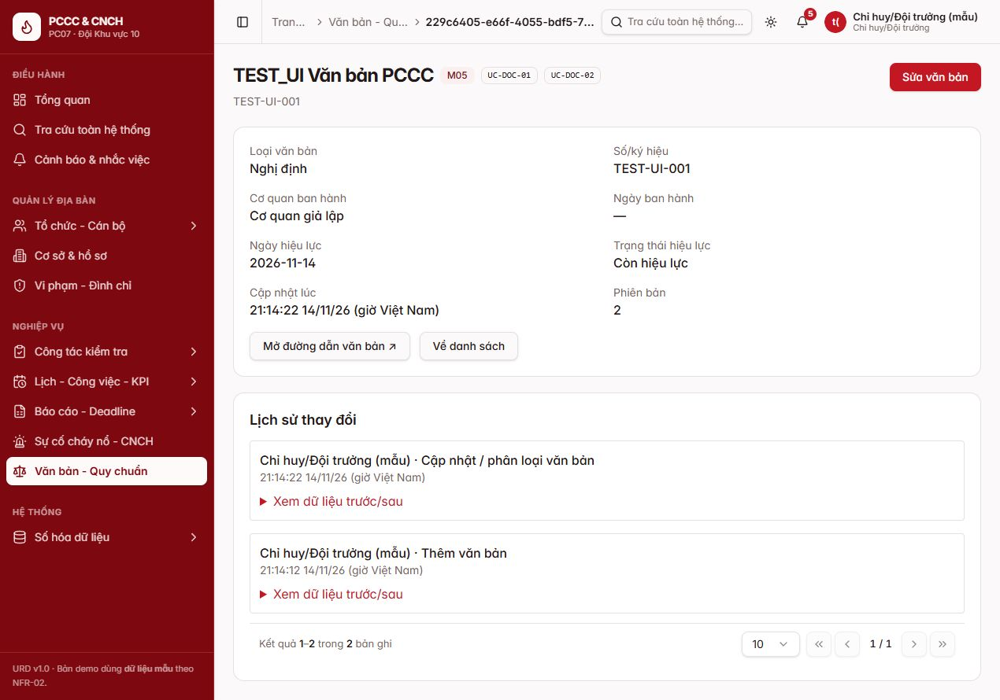
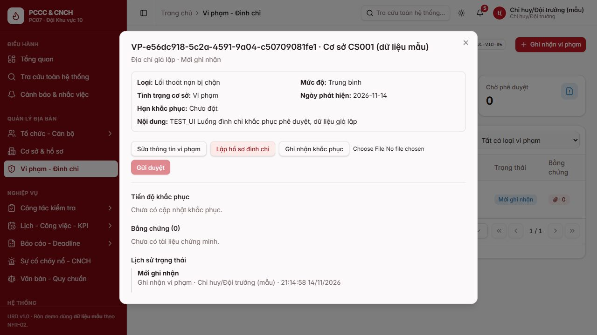

# Kết quả kiểm thử giao diện DOC/VIO

> Báo cáo lịch sử phiên 14/11. Kết quả thủ công bổ sung ngày 15–16/11 và nguồn từng testcase nằm trong [bộ bàn giao Excel](handoff/README.md). Các trạng thái BLOCKED/NOT RUN bên dưới chỉ áp dụng cho phiên cũ.

Thực hiện ngày 14/11/2026, khoảng 21:14–21:15 giờ Việt Nam. Bản Next production build riêng, localhost 3217; backend localhost 4217 với PGlite in-memory. Tài khoản demo.chi-huy và quyền M04 cấu hình cho fixture. Không dùng database người dùng.

## Kết quả thực hiện thật

| ID    | Các bước                                                                                                | Kết quả                                                                         | Minh chứng                                                                         |
| ----- | ------------------------------------------------------------------------------------------------------- | ------------------------------------------------------------------------------- | ---------------------------------------------------------------------------------- |
| UI-01 | Mở đăng nhập, nhập tài khoản chỉ huy, đăng nhập                                                         | PASS: vào tổng quan và đúng vai trò                                             | Quan sát trình duyệt; không lưu thông tin đăng nhập vào bộ bàn giao                |
| UI-02 | Kho văn bản → thêm TEST-UI-001 → loại Luật → ngày hiệu lực 14/11/2026 → link example.org/test-doc → lưu | PASS: trang chi tiết hiển thị dữ liệu và version 1                              | Tiếp tục xác minh trên UI-03                                                       |
| UI-03 | Sửa văn bản: Luật → Nghị định, Chưa hiệu lực → Còn hiệu lực → lưu                                       | PASS: version 2; lịch sử có tạo và cập nhật đúng actor                          | [Ảnh](evidence/ui-document.png)                                                    |
| UI-04 | Về danh sách → tìm TEST-UI-001                                                                          | PASS: đúng 1 bản ghi, loại/trạng thái đã cập nhật                               | [DOM snapshot](evidence/ui-document-search.txt)                                    |
| UI-05 | Mở vi phạm → ghi nhận → CS001 → loại Lối thoát nạn bị chặn → nhập nội dung → lưu                        | PASS: có mã hồ sơ, mở chi tiết, lịch sử Mới ghi nhận                            | [Ảnh](evidence/ui-violation-created.png), [DOM](evidence/ui-violation-created.txt) |
| UI-06 | Hồ sơ chưa có khắc phục/bằng chứng                                                                      | PASS ở mức UI: nút Gửi duyệt disabled                                           | [Ảnh](evidence/ui-violation-created.png); API chặn được kiểm riêng VIO-06/07       |
| UI-07 | Bấm Lập hồ sơ đình chỉ                                                                                  | BLOCKED: không thấy hộp nhập; API getJsDialog trả undefined                     | Ghi nhận giới hạn môi trường bên dưới                                              |
| UI-08 | Mở bộ chọn tệp từ Tải bằng chứng                                                                        | BLOCKED: công cụ bị ngắt trong thao tác upload; chưa xác minh upload thành công | Không gán PASS                                                                     |
| UI-09 | Ghi nhận khắc phục → gửi duyệt → đổi sang chỉ huy → duyệt                                               | NOT RUN trọn luồng UI                                                           | Luồng tương ứng đã PASS ở HTTP: VIO-01                                             |
| UI-10 | Từ chối → cập nhật → gửi lại → duyệt                                                                    | NOT RUN trọn luồng UI                                                           | Luồng tương ứng đã PASS ở HTTP: VIO-02                                             |
| UI-11 | Tải lại trang và kiểm dữ liệu hồ sơ sau thao tác                                                        | NOT RUN riêng trên browser                                                      | HTTP đã GET lại từ database; không thay thế kết quả browser reload                 |

## Giới hạn cần lưu ý

- UI M04 dùng `window.prompt` cho quyết định đình chỉ, nội dung/tiến độ khắc phục và lý do từ chối. Khi bấm lập đình chỉ trong trình duyệt in-app, ảnh/AX không thấy hộp thoại và API đọc JavaScript dialog trả undefined. Chưa có bằng chứng kết luận đây là lỗi ứng dụng trên Chrome/Edge thông thường.
- Công cụ trình duyệt bị ngắt tại bước chọn tệp và sau đó không còn khả dụng trong phiên. Không tiếp tục điều khiển UI bằng cơ chế khác sau gián đoạn.
- Mật khẩu demo ngẫu nhiên chỉ phục vụ fixture tạm, không lưu trong tài liệu.
- Văn bản UI dùng link mẫu, chưa xác minh nội dung tại website ngoài. Upload/download PDF và quyền truy cập đã kiểm qua HTTP ở DOC-01 và test có sẵn; không gọi đó là xác minh trình xem PDF bằng mắt. PDF API fixture chỉ là mẫu byte phục vụ kiểm hợp đồng API.
- Chưa có video hay minh chứng browser đầy đủ luồng đình chỉ–khắc phục–phê duyệt. Cần chạy lại UI-07..11 trên môi trường trình duyệt khả dụng trước nghiệm thu.

## Cập nhật ngày 15/11/2026

Đã thử tiếp tục bằng công cụ Windows. Yêu cầu đọc cửa sổ trình duyệt hết thời gian chờ cấp quyền (Computer Use app approval timed out). Không có thao tác nghiệp vụ UI mới; UI-07..11 vẫn chưa xác minh. Backend đã sửa và retest; xem [báo cáo retest](Retest_Report.md).
